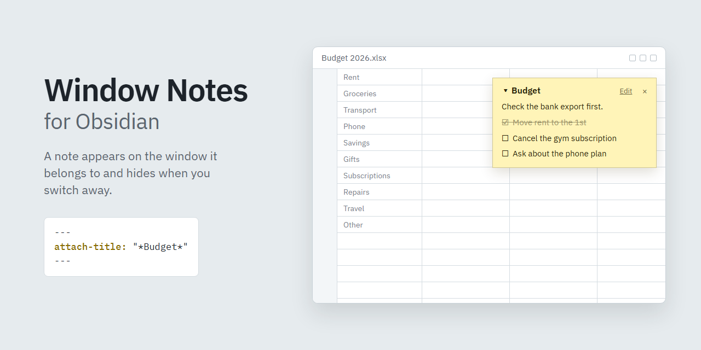

# Window Notes for Obsidian



Window Notes shows a note on top of the app or website it belongs to. Open your budget spreadsheet and your budget note appears in the corner of its window. Switch to another app and the note goes away.

Each note is an ordinary Markdown file in your Obsidian vault. You write it in Obsidian, and a line or two at the top of the file says which window it belongs to.

Runs on Windows and Linux (X11). It's an early version, so please open an issue if something doesn't work.

## Download

Get the latest version from the [Releases page](https://github.com/GusSaalfeld/window-notes-for-obsidian/releases/latest). Nothing else needs to be installed.

**Windows:** download `WindowNotes.exe` and double-click it. The program isn't signed, so Windows may show "Windows protected your PC". Click **More info**, then **Run anyway**.

**Linux:** download `window-notes-linux-x86_64.tar.gz`, then:

```
tar -xzf window-notes-linux-x86_64.tar.gz
./window-notes &
```

The downloaded versions keep their settings in `%APPDATA%\Window Notes` (Windows) or `~/.config/window-notes` (Linux).

### Or run it from source

You need Python 3.11 or newer.

- **Windows:** install Python from [python.org](https://www.python.org/downloads/windows/) and tick "Add python.exe to PATH". Download this repository, then double-click `Window Notes.bat`. To attach notes to websites, also run `pip install -r requirements.txt`.
- **Linux:** run `sudo apt install python3-tk python3-xlib` (Ubuntu/Debian), download this repository, and run `python3 window_notes.py &` in its folder.

When run from source, settings are kept in `config.toml` next to `window_notes.py`.

## First start

The first time it starts, it asks for your vault folder. A small message in the corner of the screen confirms it's running. After that you'll only see it when you're in a window that has a note.

To have it start when you log in, right-click any note and choose **Start with Windows** (or **Start at login** on Linux).

## Attach a note

The quick way: go to the window, press **Ctrl+Alt+N**, and write the note in Obsidian. The note is saved in a `Window notes` folder in your vault.

You can also attach any note in that folder by hand. Put these lines at the very top of the file:

```yaml
---
attach-app: "excel"
attach-title: "*Budget*"
---
```

There are three ways to match a window, and a note can use any of them together:

| Line | Matches | Example |
|---|---|---|
| `attach-app` | the program | `"excel"`, `"code"`, `"firefox"` |
| `attach-title` | the window title | `"*Budget 2026*"` |
| `attach-url` | the browser tab's address (Windows only) | `"github.com/*"` |

`*` stands for any text, and capitals don't matter. On Windows you can write the program name with or without `.exe`. To see a program's name, press Ctrl+Alt+N in it: the new note will have it filled in.

## Using a note

- Click the title to fold the note down to one line. It stays folded after a restart.
- Click a checkbox to tick it. The change is saved in the file.
- Click an underlined line to follow its link. `[[Other note]]` opens in Obsidian, and web links open in your browser.
- **Edit** opens the note in Obsidian.
- **×** hides the note on that window. Hidden notes come back when Window Notes restarts, so a note can't go missing for good.
- Right-click for color, opacity and the other options.

The note never takes the keyboard from the app you're typing in.

Headings, lists, checkboxes, links and callouts such as `> [!tip] Remember` are shown as plain readable text. Notes longer than 20 lines show a link to open the rest in Obsidian.

**Color.** Right-click a note and pick one of eight colors. This adds a line such as `note-color: "blue"` to the note, which you can also type yourself, including a hex color like `"#c8f7e1"`.

**Opacity.** Right-click and choose a level from 100% down to 30%. It applies to every note, and a note turns solid while your mouse is over it.

## Settings

Settings live in `config.toml`, in the settings folder described under [Download](#download). It's created on first run; [config.example.toml](config.example.toml) explains each setting.

- `vault`: your Obsidian vault, or any folder of Markdown files. Only the **Edit** button needs Obsidian.
- `folder`: where attached notes live inside the vault. Default: `Window notes`. Subfolders count too.
- `hotkey`: the letter used with Ctrl+Alt to make a new note. Default: `N`.
- `opacity`: from `0.2` to `1.0`. Default: `1.0`.

## When something goes wrong

- **Nothing seems to happen.** That's expected until you're in a window with a note. Copy [examples/Example note.md](examples/Example%20note.md) into your `Window notes` folder, then open Notepad (Windows) to see one.
- **Ctrl+Alt+N does nothing.** Another program may already use that shortcut. Pick a different letter for `hotkey` in `config.toml`.
- **A website note doesn't show up.** Run `pip install comtypes`, and check that the address in `attach-url` ends with `*`.
- **You want to see errors.** Read `window-notes.log` in the settings folder. From source on Windows, `Window Notes (debug).bat` shows them as they happen; on Linux, start it from a terminal without the `&`.

## Limits

- **Linux:** X11 only. In a Wayland session, notes work on apps that run through XWayland but not on native Wayland apps. `attach-url` isn't supported yet, so match browsers by window title instead.
- **macOS:** not supported yet.
- The note box can't be moved or resized, and you can't edit text in it.

## For developers

| File | What it does |
|---|---|
| `window_notes.py` | Settings, the note box (Tkinter) and the main loop |
| `notes.py` | Reading, matching and editing note files. No UI and no OS calls |
| `backend_windows.py` | Finding windows, window events and the hotkey on Windows (ctypes) |
| `backend_linux.py` | The same for X11 (python-xlib) |

A macOS version would be one more `backend_*.py` with the same functions. Run the tests with `python -m unittest`; GitHub runs them on Windows, Linux and macOS for every push. Pushing a tag like `v0.3.0` builds the downloads and publishes a release. The banner is `docs/banner.html`, captured at 1280×640.

## License

[MIT](LICENSE)
